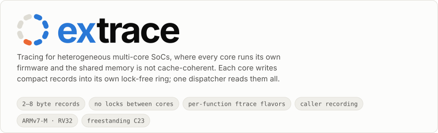
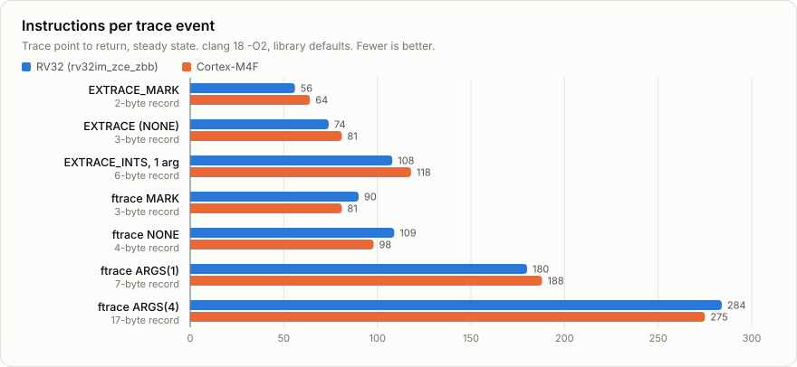
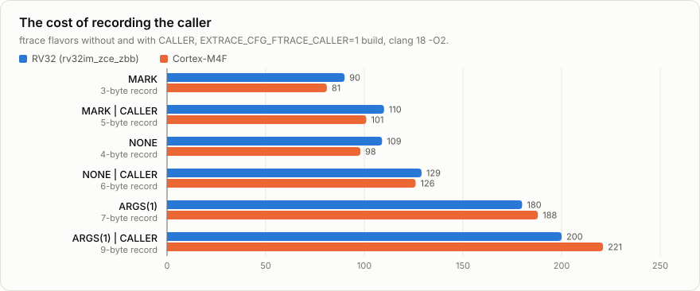

<h1 align="center">
<picture>
  <source media="(prefers-color-scheme: dark)" srcset="docs/img/banner-dark.svg">
  
</picture>
</h1>

**extrace** (embedded eXecution trace) is a tracing framework for heterogeneous
multi-core SoCs. In such a chip, subsystems run different firmware images and share
memory that is **not cache-coherent**.

> Status: implementation in progress. The target library (producer, consumer,
> record decoder, dispatcher, memory sink), the POSIX and write-buffer simulator
> ports, the build system and the test suites exist. Host tools, the remaining
> reference sinks and the ARM/RISC-V ports are next. See [DESIGN.md](DESIGN.md) for
> the full design.

## Highlights

- **Portable C23 library, no dependencies.** It runs freestanding and builds with
  gcc and clang. All platform specifics (timer, critical section, barriers,
  doorbells, compiler attributes) live in one `extrace_port.h` header of
  inline hooks. Target architectures are ARM and RISC-V, with 32-bit cores as the
  primary target: the producer never handles 64-bit time.
- **Many producers, one dispatcher.** Each producing core (AMP, one firmware
  instance per core) owns a single-producer, single-consumer ring in shared memory
  with free-running indices and a power-of-two size. There are no locks between
  subsystems and no cross-agent atomics, and each shared word has exactly one writer.
  Shared memory is non-cacheable for every agent; the port has no cache hooks.
  Shared memory is little-endian, so the common little-endian cores access it
  with plain loads and stores.
- **Robust lifecycle.** Producer and consumer initialize and re-initialize in any
  order and with any timing, starting from random or consistent shared memory.
- **Fast, compact producer API.** It is reentrant from threads and interrupts, and
  the critical section covers only pointer arithmetic. A disabled event costs one
  load, a bit test and a branch, and its arguments are not evaluated.
- **Compact varint wire format.** Typical records are 2–8 bytes and use 32-bit
  delta timestamps from the SoC-global timer (typically 1 MHz or faster). The
  varint code is a standalone, fully unrolled header module tuned for ARM and
  RISC-V (RV32 with Zbb and Zce).
- **Event kinds:** marker, no-payload, integer list, deferred printf, buffer,
  struct and string.
- **Function entry tracing (ftrace).** Functions built with
  `-fpatchable-function-entry` are patched at run time, each with its own
  flavor: call only, call and time, or call, time and the first n argument
  registers, each optionally with the caller's return address. A call record is
  3 bytes, 4 with its timestamp; an unpatched function costs 2–3 NOPs.
  Trampolines for ARMv7-M and RV32 ([docs/ftrace.md](docs/ftrace.md)).
- **Deferred printf.** The device logs a 16-bit call-site ID plus binary arguments.
  Format strings live only in the ELF, and the host does all formatting.
- **Per-event runtime enable/disable for every subsystem instance**, with
  compile-time defaults, compile-time group removal and a control API for host
  commands.
- **Drop-newest overflow handling.** Lost events are counted exactly and reported
  in-band.
- **Dispatcher with pluggable sinks.** Bulk sinks forward raw chunks with zero copy
  (for example PCIe DMA to a host). Record sinks receive parsed, filtered events (for
  example UART text or local statistics).
- **Python host tooling (planned).** One tool extracts metadata from firmware ELFs (events,
  format strings, struct layouts, enums). Another decodes captures to text, JSON
  lines or Perfetto timelines.

## Architecture at a glance

```
 FW-A                 FW-B                          FW-D (dispatcher)
 EXTRACE_*() ──┐      EXTRACE_*() ──┐              ┌──> bulk sinks ──> host (PCIe/USB)
               v                    v              │
 === shared memory, non-cacheable for all: one SPSC ring per core ===
                                                    │
                                     extrace_disp ──┴──> record sinks ──> UART, stats
```

## Function entry tracing

Build with `-fpatchable-function-entry`. At run time the platform patches the NOP
pad of each function it wants traced into a call to one trampoline entry, chosen
per function. Because the flavor is the entry the patch calls, no instructions
decide it at run time ([docs/ftrace.md](docs/ftrace.md)).

| Flavor | Records | Bytes (example) |
|---|---|---|
| `EXTRACE_FTRACE_MARK` | That the function was called | `21 C7 34` |
| `EXTRACE_FTRACE_NONE` | The call and its timestamp | `20 1D C7 34` |
| `EXTRACE_FTRACE_ARGS(n)` | Also the first n argument registers: 1–4 on ARMv7-M, 1–8 on RV32 | `22 19 0B 00 C7 34 07 AC 02 …` |
| `… \| EXTRACE_FTRACE_CALLER` | Any of these, plus the caller's return address | `41 C7 34 93 18` |

<picture>
  <source media="(prefers-color-scheme: dark)" srcset="docs/img/record-dark.svg">
  
</picture>

`extrace_ftrace_patch(pc, flavor)` checks the pad first, then rewrites it in an
order where every intermediate state is a valid program. It also changes a flavor
in place, or restores the NOPs with `EXTRACE_FTRACE_OFF`.

## Measured cost

Instructions retired from the trace point to the return, in the steady state,
counted on emulators (RV32 on QEMU with `-icount`, Cortex-M4F on unicorn) by
[`tests/perf`](tests/perf). They are instruction counts, not cycles. clang 18
`-O2`, library defaults; [`bench/run.sh`](bench/run.sh) reproduces
[`bench/results.txt`](bench/results.txt), which the figures below are generated
from (`docs/img/gen_svg.py`). Details in [docs/performance.md](docs/performance.md).

<picture>
  <source media="(prefers-color-scheme: dark)" srcset="docs/img/stats-dark.svg">
  
</picture>

<picture>
  <source media="(prefers-color-scheme: dark)" srcset="docs/img/cost-dark.svg">
  
</picture>

<picture>
  <source media="(prefers-color-scheme: dark)" srcset="docs/img/caller-dark.svg">
  
</picture>

<details>
<summary>The numbers as a table</summary>

| Event | Record bytes | RV32 | Cortex-M4F |
|---|---|---|---|
| `EXTRACE_MARK` | 2 | 56 | 64 |
| `EXTRACE` (NONE) | 3 | 74 | 81 |
| `EXTRACE_INTS`, 1 argument | 6 | 108 | 118 |
| ftrace MARK | 3 | 90 | 81 |
| ftrace NONE | 4 | 109 | 98 |
| ftrace ARGS(1) | 7 | 180 | 188 |
| ftrace ARGS(4) | 17 | 284 | 275 |
| ftrace MARK \| CALLER | 5 | 110 | 101 |
| ftrace NONE \| CALLER | 6 | 129 | 126 |
| ftrace ARGS(1) \| CALLER | 9 | 200 | 221 |
| Event switched off | 0 | 4 | 5 |
| Traced function, unpatched | 0 | 2 | 3 |
| Patched, FTRACE switch off | 0 | 6 | 9 |

</details>

## Quick start

The library is compiled per firmware image, so the image's port header, event
catalog and configuration apply.

```cmake
# CMakeLists.txt
include(extrace/cmake/extrace.cmake)
enable_language(ASM)
extrace_add_image(fw_a
    PORT_DIR    port      # extrace_port.h
    EVENTS_DIR  events    # extrace_events.def
    COMPONENTS  prod
    FTRACE_ARCH armv7m)   # or rv32; optional
target_link_libraries(fw_a.elf PRIVATE fw_a::extrace)
```

```c
/* events/extrace_events.def */
EXTRACE_GROUP(CORE, 1)
EXTRACE_EV(RX_PKT, INTS,   ON, CORE, "len:u port:u")
EXTRACE_EV(LOG,    PRINTF, ON, CORE, "")
```

```c
/* firmware */
#include "extrace.h"

extrace_prod_init(&cfg);          /* any time, any order */

EXTRACE_INTS(RX_PKT, len, port);  /* 1-16 integers */
EXTRACE_PRINTF(LOG, "rx %u on %u", len, port);

/* host command: trace f() with 2 args and its caller */
extrace_ftrace_patch(pc_of_f, EXTRACE_FTRACE_ARGS(2) | EXTRACE_FTRACE_CALLER);

extrace_prod_poll();              /* periodic, one task */
```

See [docs/producer.md](docs/producer.md) and [docs/consumer.md](docs/consumer.md)
for the full integration. A one-page overview for sharing is in
[docs/flyer.html](docs/flyer.html) (open it in a browser).

## Layout

| Path | Content |
|---|---|
| `include/extrace/`, `src/` | Producer, consumer, record decoder, dispatcher and sinks (separate link units) |
| `port/` | Compiler macros, port template, POSIX port, write-buffer simulator (`wbsim`), ftrace trampolines (`arch/armv7m`, `arch/rv32`) |
| `linker/` | Linker fragments: metadata sections, ftrace site table (both kept in the ELF only) |
| `cmake/` | Per-image integration helper (`extrace_add_image`) |
| `docs/` | Integration guides: [producer](docs/producer.md), [consumer](docs/consumer.md); [wire format](docs/wire-format.md) and its [interactive view](docs/wire-encodings.html); [function entry tracing](docs/ftrace.md); [performance](docs/performance.md); [flyer](docs/flyer.html); logo and README figures (`img/`, generated by `img/gen_svg.py`) |
| `bench/` | `run.sh` reproduces the producer instruction counts into `results.txt` |
| `tests/` | Varint, unit (with a configuration matrix), concurrency, lifecycle, interleaving and ftrace emulator tests on unicorn and QEMU (CTest); producer instruction counts and a before/after equivalence check (`tests/perf`) |

## Build and test

```bash
cmake --preset test && cmake --build --preset test && ctest --preset test
```

- `test`: every suite under AddressSanitizer and UndefinedBehaviorSanitizer, warnings as errors.
- `tsan`: the same suites under ThreadSanitizer; the POSIX port then uses
  acquire/release accesses instead of fences, which ThreadSanitizer does not model.
- `coverage`, `release-check`, `dev`: coverage instrumentation, optimized build, plain debug build.

The memory-ordering tests run the producer and the consumer on the write-buffer
simulator (`port/wbsim`): every core has a private view of shared memory, stores
drain in random order (newest first included), loads may return stale values, and
only the port's barriers restore order. A seeded scheduler switches between the
producer's threads, an ISR and the consumer at every shared-memory access, so a
failing schedule is reproduced from its seed. Random runs (`test_lifecycle`) and
scripted exhaustive interleavings (`test_interleave`) check record integrity, exact
loss accounting, configuration and lifecycle invariants across producer and
consumer restarts. Removing a barrier or a protocol check, one at a time, makes
these tests fail. The exceptions are the barriers that order loads before later
stores (C5, R2), which the simulator does not model, and checks that are
redundant with a later barrier.

## Conventions

- C23, gcc 13+ or clang 17+, warning-free with `-Wall -Wextra -Wconversion -Wshadow`.
- C code follows the Linux kernel coding style with 4-space indentation (`.clang-format`), uses
  kernel-style compiler macros (`__used`, `__maybe_unused`, `likely()`, ...) from the
  port layer, and prefers inline functions to macros.

## License

MIT, see [LICENSE](LICENSE).
